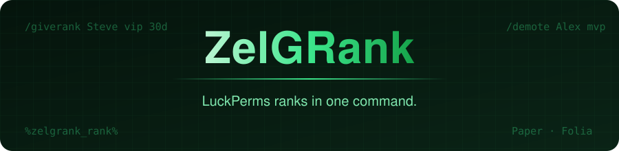
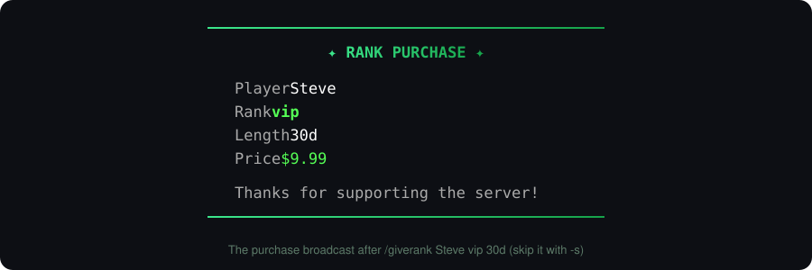

<div align="center">
  

  <h3>Give, renew and remove LuckPerms ranks with one command, on Paper and Folia.</h3>

  <a href="https://github.com/Xenos-core/ZelGRank/actions"></a>
  <a href="https://github.com/Xenos-core/ZelGRank/releases"></a>
  <a href="https://github.com/Xenos-core/ZelGRank/releases"></a>
  <br>
  
  
  
</div>

<br>

ZelGRank is a small layer on top of LuckPerms for servers that sell ranks. `/giverank Steve vip 30d` gives the
rank, adds the time on top if Steve already has it, and posts a purchase announcement in chat. Players get a
heads-up on join when a rank is about to run out, and staff can open `/ginfo` to see who has what and for how long.

<div align="center">
  
</div>

<h3>Features</h3>

- **One command.** Give a rank for a while or forever, no `lp user ... parent addtemp` to remember
- **Renewals stack.** Giving 30d to someone with 5d left leaves them with 35d, and a permanent give replaces a temp one
- **Purchase broadcast.** Configurable lines, price per rank or per duration, sound, everyone or staff only. Add `-s` to skip it
- **Expiry warnings.** Players see which ranks end soon when they join
- **Rank menu.** `/ginfo <player>` shows every rank, sorted by weight, with time left
- **Placeholders.** Highest rank, rank count and time left for scoreboards and tab
- **Developer API.** Give and remove ranks from your own plugin, plus events for both
- **Folia ready.** Runs on region threads with no extra setup

<h3>Installation</h3>

1. Install [LuckPerms](https://luckperms.net/download)
2. Download ZelGRank from [Releases](https://github.com/Xenos-core/ZelGRank/releases) and drop it into `plugins/`
3. Restart, then edit `config.yml` and `messages.yml` in `plugins/ZelGRank/` and run `/zelgrank reload`

Needs Paper or Folia 1.21+ on Java 21. [PlaceholderAPI](https://modrinth.com/plugin/placeholderapi) is optional.

<h3>Commands</h3>

| Command | What it does | Permission |
|---|---|---|
| `/giverank <player> <rank> [duration] [-s]` | Give or extend a rank. No duration means permanent | `zelgrank.give` |
| `/demote <player> <rank>` | Remove a rank | `zelgrank.demote` |
| `/ginfo <player>` | Open the rank menu | `zelgrank.info` |
| `/zelgrank reload` | Reload both config files | `zelgrank.reload` |

Durations look like `30s`, `15m`, `12h`, `7d`, `2w`, `1M`, `1y`, and can be chained: `1d12h`.

```
/giverank Steve vip 30d
/giverank Steve vip 30d -s     # same, without the broadcast
/giverank Alex mvp             # permanent
/demote Steve vip
```

<details>
<summary><b>Permissions</b></summary>
<br>

| Permission | Purpose | Default |
|---|---|---|
| `zelgrank.admin` | All of the below | op |
| `zelgrank.give` | `/giverank` | op |
| `zelgrank.demote` | `/demote` | op |
| `zelgrank.info` | `/ginfo` | op |
| `zelgrank.reload` | `/zelgrank reload` | op |
| `zelgrank.notify` | See broadcasts when `recipients: staff` | op |

</details>

<h3>Configuration</h3>

```yaml
broadcast:
  enabled: true
  recipients: all          # all, staff or none
  lines:
    - "<green>✦ RANK PURCHASE ✦"
    - "<gray>Player</gray> <white><player>"
    - "<gray>Rank</gray> <green><rank>"
    - "<gray>Price</gray> <green>$<price>"
  sound:
    enabled: true
    name: "entity.experience_orb.pickup"

rank-prices:
  default: "0.00"
  vip:                     # a price per duration...
    30d: "9.99"
    permanent: "29.99"
    default: "9.99"
  mvp: "29.99"             # ...or just one price

expiry-warning:
  enabled: true
  within: 24h
```

Every message is in `messages.yml` and uses [MiniMessage](https://docs.advntr.dev/minimessage/format.html).
Set one to `""` to turn it off. Old `{player}` style placeholders still work.

<details>
<summary><b>Placeholders</b></summary>
<br>

Needs PlaceholderAPI. Values are for online players.

| Placeholder | Example |
|---|---|
| `%zelgrank_rank%` | `mvp` (highest weight) |
| `%zelgrank_rankcount%` | `2` |
| `%zelgrank_hasrank%` | `true` |
| `%zelgrank_hasrank_<rank>%` | `false` |
| `%zelgrank_expires%` | `86400` (seconds until the next rank ends) |
| `%zelgrank_expires_formatted%` | `1d 2h` |
| `%zelgrank_expires_<rank>%` | `6d 4h` or `Permanent` |

</details>

<details>
<summary><b>Developer API</b></summary>
<br>

```java
ZelGRankApi api = Bukkit.getServicesManager().load(ZelGRankApi.class);

api.giveRank(uuid, "Steve", "vip", Duration.ofDays(30), null).thenAccept(result -> {
    switch (result.status()) {
        case GIVEN, EXTENDED -> getLogger().info("vip until " + result.expiry().orElseThrow());
        case ALREADY_PERMANENT -> getLogger().info("Steve already has vip for good");
        default -> getLogger().warning("Couldn't give vip: " + result.status());
    }
});
```

| Method | Returns |
|---|---|
| `giveRank(uuid, name, rank, duration, actor)` | `CompletableFuture<RankChangeResult>` |
| `removeRank(uuid, name, rank, actor)` | `CompletableFuture<RankChangeResult>` |
| `getRanks(uuid)` | `CompletableFuture<List<RankInfo>>`, highest weight first |
| `getCachedRanks(uuid)` | `List<RankInfo>` for online players, no storage lookup |
| `hasRank(uuid, rank)` | `CompletableFuture<Boolean>` |
| `lookupUniqueId(name)` | `CompletableFuture<Optional<UUID>>` |

`ZelGRankGivenEvent` and `ZelGRankRemovedEvent` fire after the change is saved, on the global region thread.
The API never sends the purchase broadcast, only `/giverank` does.

</details>

<h3>Upgrading from 1.x</h3>

Messages moved from `config.yml` to `messages.yml`, and the sound now takes a key like
`entity.experience_orb.pickup` instead of `ENTITY_EXPERIENCE_ORB_PICKUP`. The easiest way is to rename your old
`config.yml`, let ZelGRank write fresh files, and copy your prices and lines back in.

<h3>Building</h3>

```bash
git clone https://github.com/Xenos-core/ZelGRank.git
cd ZelGRank
mvn package
```

The jar lands in `target/`. Every push also gets built by
[GitHub Actions](https://github.com/Xenos-core/ZelGRank/actions).
